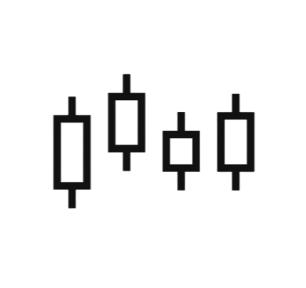
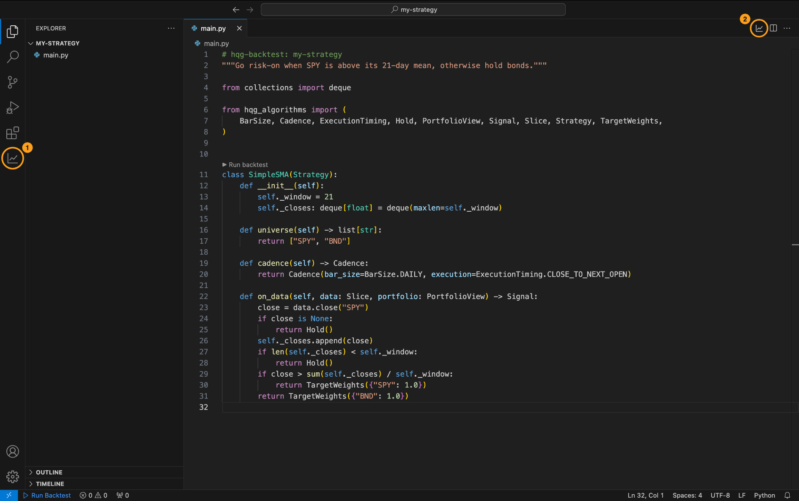
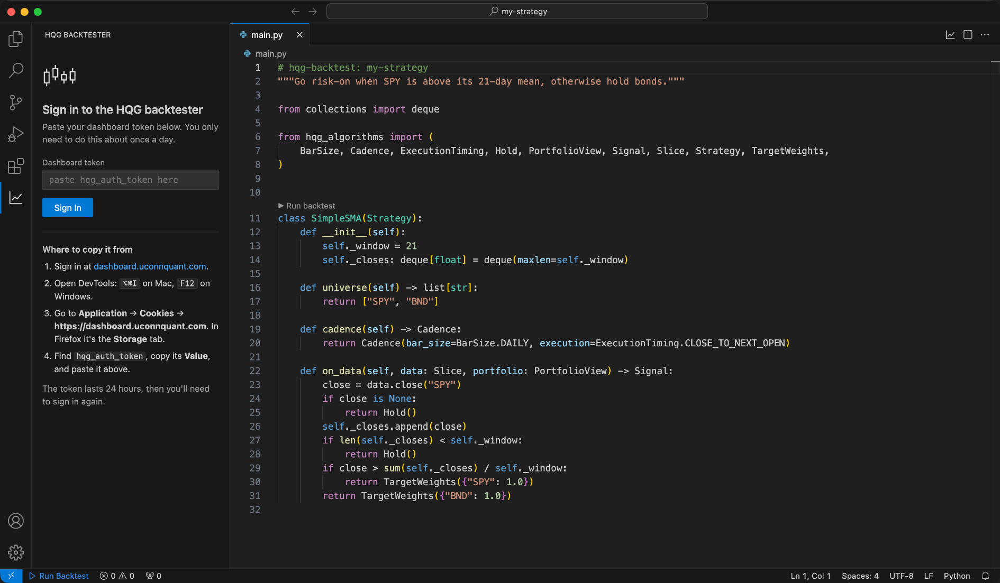
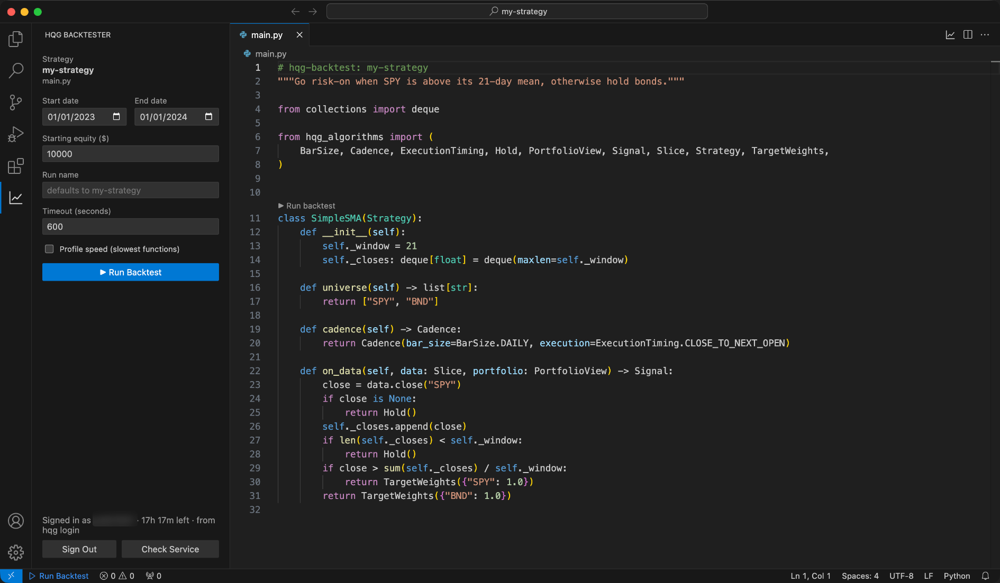
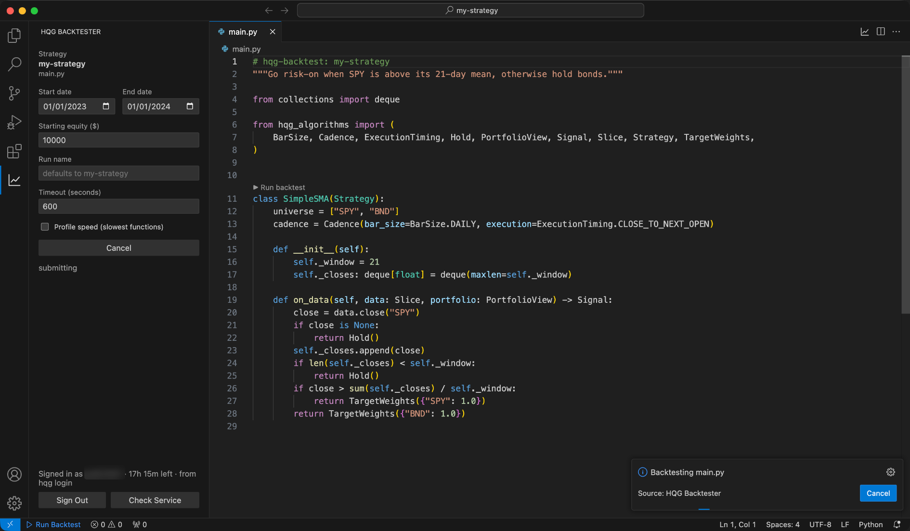
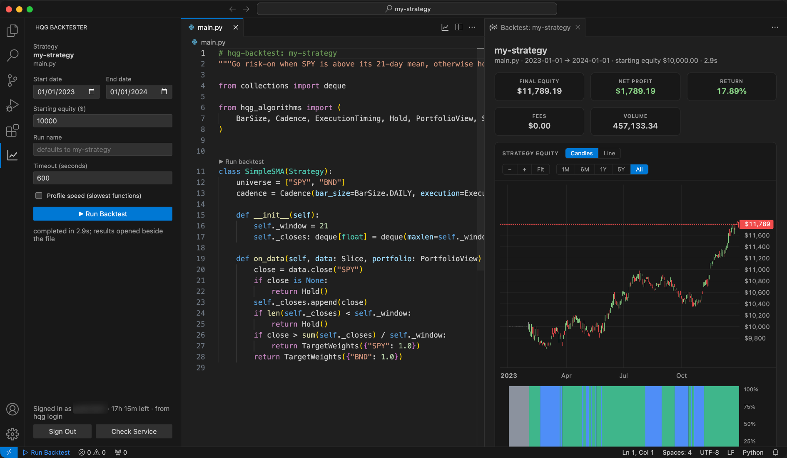
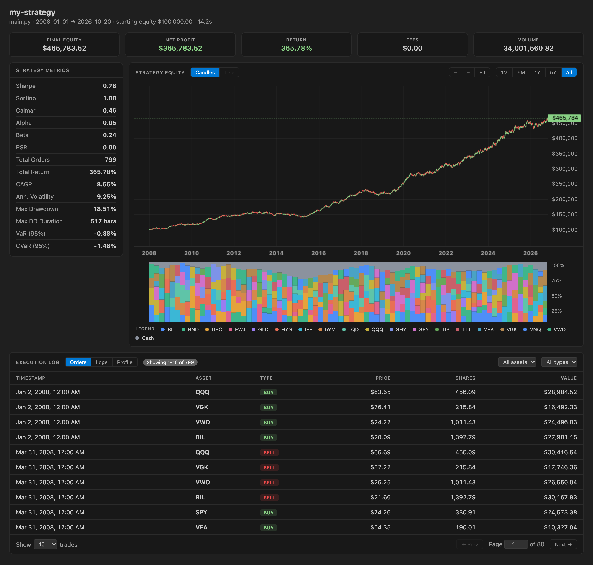
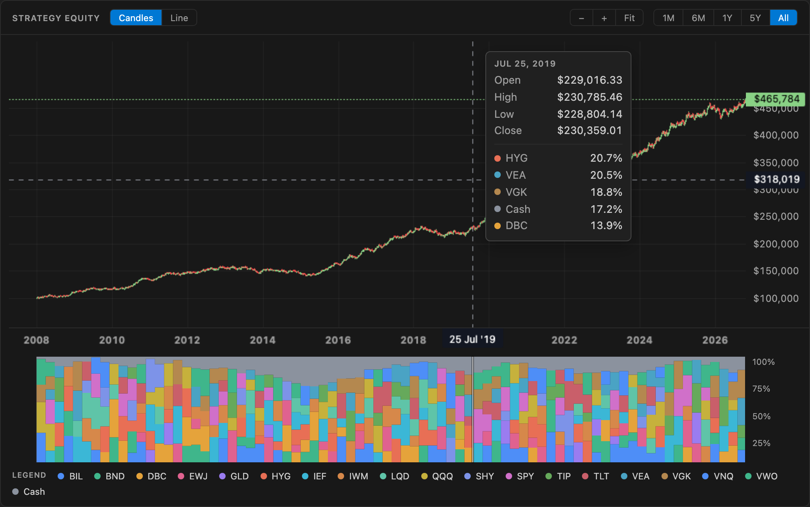

<p align="center">
  <picture>
    <source media="(prefers-color-scheme: dark)" srcset="media/logo-white.png">
    
  </picture>
</p>

<h1 align="center">HQG Backtester for VS Code</h1>

<p align="center">
  Run a strategy on the HQG backtester without leaving the editor, and see the results in a tab beside your code.
</p>

This extension does what the HQG command line tool (`hqg`, from [hqg-backtester](https://github.com/Husky-Quantitative-Group/hqg-backtester)) does: it sends your
strategy to the HQG backtester and waits for the result. You pick the dates and starting equity in
a side panel, press **Run Backtest**, and get the dashboard's results view inside VS Code.

You build and install it on your own computer. It is not on the VS Code Marketplace. The steps
below take about five minutes, and you don't need to read any code.

- [Install](#install)
- [Sign in](#sign-in)
- [Mark your strategy file](#mark-your-strategy-file)
- [Run a backtest](#run-a-backtest)
- [Read the results](#read-the-results)
- [Update to a newer version](#update-to-a-newer-version)
- [Troubleshooting](#troubleshooting)
- [Develop the extension](#develop-the-extension)

## Install

### What you need

| | How to check | Where to get it |
| --- | --- | --- |
| **VS Code 1.90 or newer** | **Code → About Visual Studio Code** | [code.visualstudio.com](https://code.visualstudio.com) |
| **Git** | `git --version` in a terminal | [git-scm.com](https://git-scm.com/downloads) |
| **Node.js 18 or newer**, which includes `npm` | `node --version` | [nodejs.org](https://nodejs.org), the LTS version |
| **An HQG dashboard account** with backtester access | You can sign in at [dashboard.uconnquant.com](https://dashboard.uconnquant.com) | Ask an HQG admin |

On Mac, keep VS Code in your **Applications** folder. If it runs from Downloads, the `code`
command used in step 4 can't be set up.

### Step 1: Get the code

Open a terminal and run:

```bash
git clone https://github.com/Husky-Quantitative-Group/hqg-vscode.git
cd hqg-vscode
```

### Step 2: Install the build tools

```bash
npm install
```

This downloads what the extension needs into a `node_modules` folder. It takes a minute and only
has to be done once.

### Step 3: Build the extension

```bash
npm run package
```

This creates a file called `hqg-vscode-0.0.1.vsix` in the `hqg-vscode` folder. That file is the
extension.

### Step 4: Install it in VS Code

```bash
code --install-extension hqg-vscode-0.0.1.vsix
```

You should see `Extension 'hqg-vscode-0.0.1.vsix' was successfully installed.`

<details>
<summary><b>If it says <code>code: command not found</code></b></summary>

1. Open VS Code.
2. Press `⇧⌘P` (`Ctrl+Shift+P` on Windows) to open the Command Palette.
3. Type **Shell Command: Install 'code' command in PATH** and press Enter.
4. Close your terminal, open a new one, `cd` back into `hqg-vscode`, and run step 4 again.

If you'd rather not use the terminal: in VS Code, open the Extensions view (`⇧⌘X`), click the
**⋯** menu at the top of the view, choose **Install from VSIX…**, and pick
`hqg-vscode-0.0.1.vsix`.
</details>

### Step 5: Reload VS Code

Press `⇧⌘P` (`Ctrl+Shift+P` on Windows), type **Developer: Reload Window**, and press Enter.

### Step 6: Find the extension's icons

Open any Python file that has the `# hqg-backtest` line (see
[Mark your strategy file](#mark-your-strategy-file)). The extension adds two chart icons:



1. **The line-chart icon in the Activity Bar**, on the far left. It opens the **HQG Backtester**
   panel, and it's always there, even with no strategy open.
2. **The chart icon above the file**, at the top-right of the editor. It shows only while a
   strategy file is the current tab, and opens the same panel.

You run backtests from inside the panel, with its **Run Backtest** button.

The extension is installed. Next, sign in.

## Sign in

Click the line-chart icon in the Activity Bar. The first time, the panel asks for your dashboard token:



1. Sign in at [dashboard.uconnquant.com](https://dashboard.uconnquant.com).
2. Open your browser's DevTools: `⌥⌘I` on Mac, `F12` on Windows.
3. Go to **Application** → **Cookies** → **https://dashboard.uconnquant.com**. In Firefox it's the
   **Storage** tab.
4. Copy the **Value** of `hqg_auth_token`, paste it into the panel, and press **Sign In**.

The extension checks the token with the backtester before saving it, and tells you if it's wrong
or expired.

- **Tokens last 24 hours.** The bottom of the panel shows how long you have left. When the token
  expires, the panel asks you to sign in again.
- **Already use the [HQG command line tool](https://github.com/Husky-Quantitative-Group/hqg-backtester#hqg-cli)?** If you've run `hqg login`, you're already signed in.
  The extension reads the same token from `~/.hqg/credentials`.
- **Sign Out** at the bottom of the panel signs you out of the extension only. Your
  `~/.hqg/credentials` file is left alone, so the HQG command line tool stays signed in.

## Mark your strategy file

Add this line near the top of your strategy file, with your strategy's name after the colon:

```python
# hqg-backtest: <strategy-name>
```

- **It's a comment, so Python ignores it.** It can go on line 1, even above the module docstring.
- **It has to be within the first 10 lines**, on a line of its own.
- **The name is used for the run.** It shows in the panel and at the top of the results. With a
  bare `# hqg-backtest`, the file name is used instead.
- **Spaces are optional:** `#hqg-backtest:<strategy-name>` works too.

Only files with this line can be backtested. That keeps the run buttons away from your other
Python files.

## Run a backtest

1. Open your strategy file, so it's the current tab.
2. Open the panel: click the line-chart icon in the Activity Bar, or the chart icon above the
   file (see [step 6](#step-6-find-the-extensions-icons)). The panel shows your strategy's name
   and the run settings:

   

3. Fill in the run. The panel remembers your values for next time.

   | Field | What it does |
   | --- | --- |
   | **Start date / End date** | The period to backtest. |
   | **Starting equity ($)** | The cash the strategy starts with. |
   | **Run name** | Leave empty to use the name from `# hqg-backtest`. Anything you type here is used for every strategy until you clear it. |
   | **Timeout (seconds)** | How long to wait for the result before giving up. The run may still finish on the server. |
   | **Profile speed (slowest functions)** | Times every function while your strategy runs and lists the 40 slowest in the results' **Profile** tab. Use it to find out why a backtest is slow. The run takes a little longer, so leave it off normally. |

4. Press **▶ Run Backtest**. While it runs, the panel shows the job's progress and a **Cancel**
   button, and VS Code shows a progress notification at the bottom-right:

   

5. When it finishes, the results open in a tab on the right, beside your code:

   

   See [Read the results](#read-the-results) for what everything in it means.

**The panel follows the current tab.** Switch to another strategy file and the panel switches with
it. Switch to a file without the `# hqg-backtest` line, or close your strategy, and the panel asks
you to open one, with **Run Backtest** greyed out. You can click into the results tab while your
strategy is still visible beside it, and the panel keeps the strategy, so you can run again straight
away.

**Want the panel on the right**, next to Claude Code or Copilot? Drag the line-chart icon from the
Activity Bar into the Secondary Side Bar. VS Code remembers where you put it.

## Read the results

When the backtest finishes, the results open in a tab beside your code. The tab has the HQG
candlestick icon <picture><source media="(prefers-color-scheme: dark)" srcset="media/candles-dark.svg"></picture>.
Each run opens its own tab, so you can compare runs side by side.



- **Along the top:** final equity, net profit, return, fees and volume.
- **Strategy metrics**, on the left: Sharpe, Sortino, Calmar, alpha, beta, drawdown, VaR and more.
- **Strategy equity:** your portfolio's value over time.
  - Switch between **Candles** and **Line**.
  - Jump to the last **1M / 6M / 1Y / 5Y**, or show **All**.
  - Zoom with **− / +**, by scrolling over the chart, or by dragging the price axis. **Fit** shows
    the whole run again. Drag the chart to pan.
  - When zoomed in, thin scrollbars appear along the bottom (time) and right side (price) of the
    chart. Double-click the price scrollbar to fit prices again.
  - **Grey bars mean the portfolio was 100% cash.** You'll often see this at the start, while a
    strategy collects enough price history to make its first decision.
- **Allocation:** what share of the portfolio each asset held over time. Each step is a
  rebalance.
- **Execution log:** every order, with filters by asset and buy/sell, and 10–100 orders per page.
  The **Logs** tab has your strategy's `self.log()` output. The **Profile** tab appears when you
  ran with **Profile speed** on.

Hover over either chart to see that day's prices and holdings:



**If a run fails**, the error shows in a notification and in the panel. If the error names a line
in your file, that line gets a red squiggle, which goes away once you edit the file. Everything
from each run, including `self.log()` output, is also written to the **HQG Backtest** channel in
VS Code's Output panel (**View → Output**).

## Update to a newer version

From the `hqg-vscode` folder:

```bash
git pull
npm install
npm run package
code --install-extension hqg-vscode-0.0.1.vsix --force
```

Then run **Developer: Reload Window**. Results tabs that were already open keep the old version
until you run the backtest again.

## Troubleshooting

| What you see | What to do |
| --- | --- |
| No line-chart icon in the Activity Bar | Run **Developer: Reload Window**. If it's still missing, run step 4 again and check it says `successfully installed`. |
| **Run Backtest** is greyed out | Make your strategy file the current tab, and check that `# hqg-backtest: <strategy-name>` is within its first 10 lines. |
| The chart icon above the file doesn't show | Same as above. The `# hqg-backtest` line must be on its own, not after code. |
| `npm: command not found` | Install Node.js (see [What you need](#what-you-need)), then open a new terminal. |
| "The backtester turned down your sign-in" | Your token was rejected. Sign in to the dashboard again and paste the new token. |
| "Your sign-in expired" | Tokens last 24 hours. Copy a fresh one from the dashboard. |
| The equity line is flat and grey at the start | That's warm-up: your strategy was all cash while it gathered price history. The backtester sends no data from before your start date, so start the backtest earlier if you need results from a specific date. |
| Not sure the backtester is up | Press **Check Service** at the bottom of the panel. |

**Setting:** `hqg.apiUrl` points the extension at a different backtester, for example one you run
locally. The default is `https://platform.uconnquant.com/backtester`.

## Develop the extension

After step 2, open the `hqg-vscode` folder in VS Code and press **F5**. A second VS Code window
opens with your development copy of the extension loaded. After changing code, run
**Developer: Reload Window** in that second window. To share your changes as a `.vsix`, run
`npm run package` again.

| Path | What's there |
| --- | --- |
| `src/extension.ts` | Commands, the run flow, sign-in, and which file counts as the strategy |
| `src/panel.ts`, `media/panel.*` | The side panel |
| `src/results.ts`, `media/results.*` | The results tab |
| `src/api.ts` | The backtester API client, the same calls as [`cli/api.py`](https://github.com/Husky-Quantitative-Group/hqg-backtester/blob/main/cli/api.py) in hqg-backtester |
| `src/auth.ts` | Token storage, and reading `~/.hqg/credentials` |
| `docs/images/` | The screenshots in this README |
